# ♻ Circular Carbon Toolkit

**LCA / Product Carbon Footprints, Scope 1-2-3 accounting and sustainable procurement for a circular paper value chain**

Recovered paper → recycled cartonboard → folding cartons & gypsum board


> **Interactive dashboard:** open [`docs/index.html`](docs/index.html) in a browser, or enable GitHub Pages (Settings → Pages → Branch `main`, folder `/docs`). It will then be live at [malleshkomal.github.io/circular-carbon-toolkit](https://malleshkomal.github.io/circular-carbon-toolkit/).

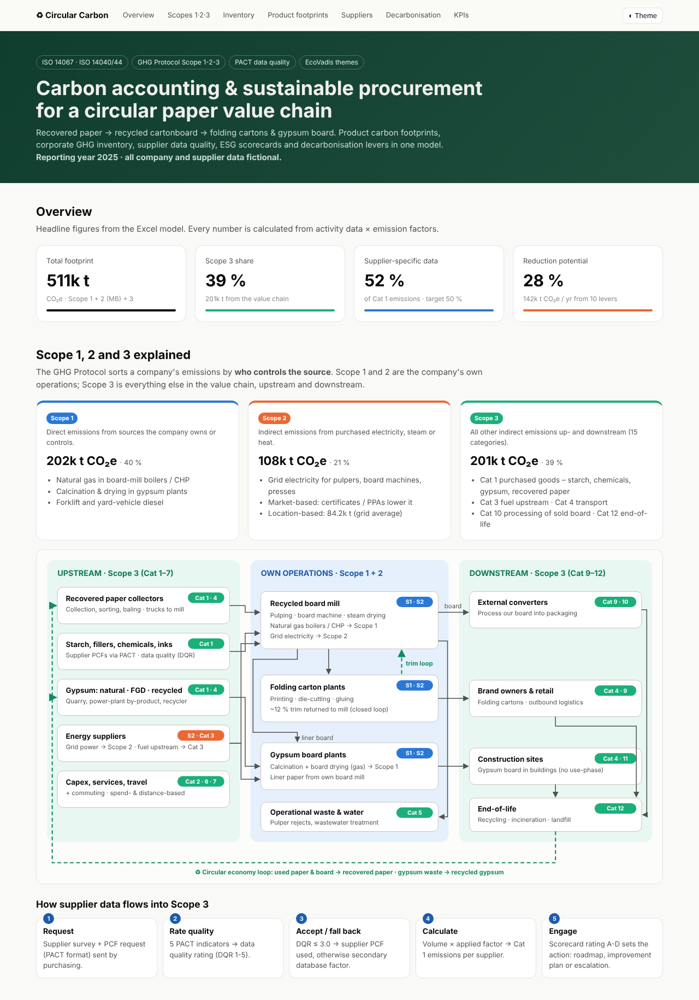

---

## Contents

1. [What this project shows](#1-what-this-project-shows)
2. [Scope 1, 2 and 3 explained](#2-scope-1-2-and-3-explained)
3. [Results](#3-results)
4. [Product carbon footprints (LCA)](#4-product-carbon-footprints-lca)
5. [Supplier data & sustainable procurement](#5-supplier-data--sustainable-procurement)
6. [Decarbonisation levers](#6-decarbonisation-levers)
7. [How the model works](#7-how-the-model-works)
8. [Repository structure & how to run](#8-repository-structure--how-to-run)
9. [Methodology & limitations](#9-methodology--limitations)

---

## 1. What this project shows

The company is fictional. It runs a **circular business model**: it buys recovered paper (RCP), turns it into 100 % recycled cartonboard in its own mills, and sells the board externally. It also converts the board into **folding cartons** and uses it as **liner paper for gypsum board**. Trim waste from converting goes back to the mill, and used products return as recovered paper or recycled gypsum.

| Task | Where |
|---|---|
| Product Carbon Footprints (PCF) per ISO 14067 | `PCF_Board`, `PCF_FoldingCarton`, `PCF_GypsumBoard` |
| Corporate GHG inventory, Scope 1, 2 (location + market) and all 15 Scope 3 categories | `GHG_Inventory` |
| Collecting and validating supplier CO₂ data (PACT data quality rating) | `Supplier_Register` |
| Supplier ESG evaluation (EcoVadis themes + climate maturity) | `Supplier_Scorecard` |
| KPIs and scorecards for sustainable procurement | `KPI_Dashboard` |
| Decarbonisation potential and abatement cost (MACC) | `Decarbonisation` |
| Supplier survey and internal training programme | `Supplier_Survey`, `Training_Plan` |

---

## 2. Scope 1, 2 and 3 explained

The **GHG Protocol** groups a company's emissions by *who controls the source*:

| Scope | What it covers | In this business | Result |
|---|---|---|---|
| 🔵 **Scope 1** – direct | Fuel burned in sources the company owns or controls | Natural gas in board-mill boilers/CHP, gypsum calcination & drying, forklift diesel | **202,029 t CO₂e** (40 %) |
| 🟠 **Scope 2** – purchased energy | Electricity, steam or heat bought from others | Grid power for pulpers, board machines, printing presses | **107,900 t** market-based (21 %) · 84,232 t location-based |
| 🟢 **Scope 3** – value chain | Everything else, upstream and downstream (15 categories) | Starch, chemicals, gypsum, transport, fuel upstream, processing of sold board, end-of-life | **201,170 t** (39 %) |

### Value chain and scope boundaries

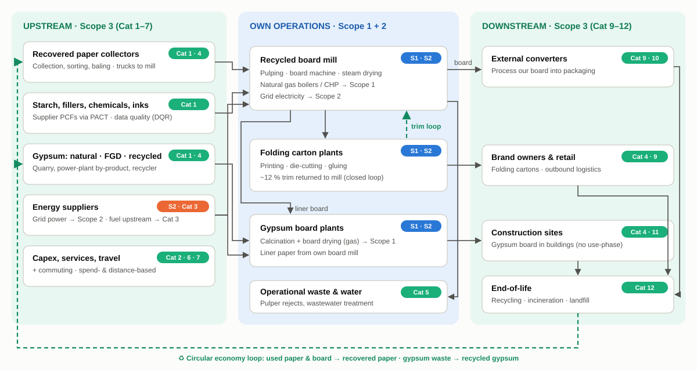

### Scope flow

```mermaid
flowchart LR
    subgraph UP["⬅ UPSTREAM · Scope 3"]
        direction TB
        RCP["Recovered paper collectors<br/>Cat 1 · Cat 4"]
        MAT["Starch · fillers · chemicals · inks<br/>Cat 1"]
        GYP["Gypsum: natural · FGD · recycled<br/>Cat 1 · Cat 4"]
        FUEL["Fuel & power production<br/>Cat 3"]
        CAP["Capex · services · travel · commuting<br/>Cat 2 · 6 · 7"]
    end
    subgraph OWN["🏭 OWN OPERATIONS · Scope 1 + 2"]
        direction TB
        MILL["Recycled board mill<br/>S1 gas · S2 electricity"]
        FC["Folding carton plants<br/>S1 · S2"]
        GB["Gypsum board plants<br/>S1 calcination & drying · S2"]
        WASTE["Rejects & wastewater<br/>Cat 5"]
        MILL -->|board| FC
        MILL -->|liner board| GB
        FC -.->|"♻ 12 % trim"| MILL
        MILL --> WASTE
    end
    subgraph DOWN["➡ DOWNSTREAM · Scope 3"]
        direction TB
        CONV["External converters<br/>Cat 9 · Cat 10"]
        RET["Brand owners & retail<br/>Cat 4 outbound · Cat 9"]
        BUILD["Construction<br/>Cat 11: no use-phase emissions"]
        EOL["End-of-life<br/>Cat 12"]
        CONV --> EOL
        RET --> EOL
        BUILD --> EOL
    end
    GRID(["Electricity grid<br/>Scope 2"])

    UP ==>|raw materials, energy, services| OWN
    GRID ==> OWN
    OWN ==>|board · cartons · gypsum board| DOWN

    classDef s1 fill:#e6f0fc,stroke:#2a78d6,color:#0b0b0b
    classDef s3 fill:#e8f7f1,stroke:#1baf7a,color:#0b0b0b
    classDef s2 fill:#fdeee7,stroke:#eb6834,color:#0b0b0b
    class MILL,FC,GB s1
    class RCP,MAT,GYP,CAP,FUEL,WASTE,CONV,RET,BUILD,EOL s3
    class GRID s2
```

♻ **Closing the loop:** used cartons and board come back as recovered paper, and gypsum waste comes back as recycled gypsum. Both re-enter at the upstream end (see the dashed loop in the diagram above).

### Scope 2: location-based vs market-based

The same kilowatt-hours can be reported two ways. Both are required by the GHG Protocol Scope 2 Guidance.

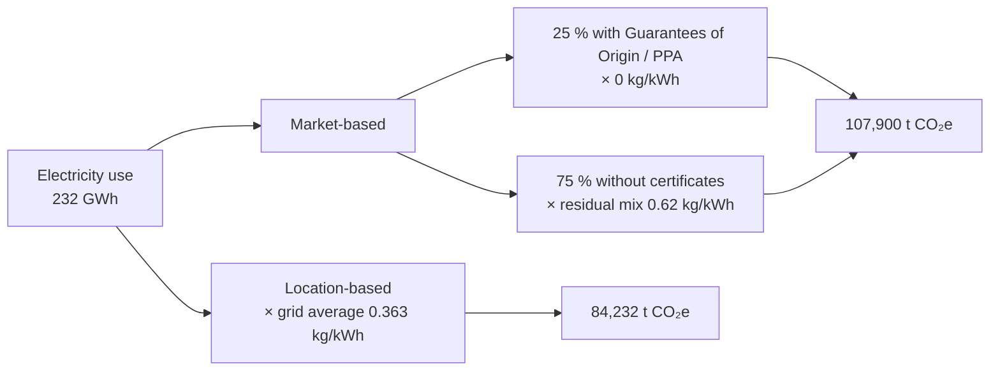

> The residual mix is "dirtier" than the grid average because certified renewable power has already been claimed by others. That is why market-based Scope 2 is *higher* here until the renewable share goes up (lever L01).

### The 15 Scope 3 categories in this business

| # | Category | Status | Method | t CO₂e |
|---|---|---|---|---:|
| 1 | Purchased goods & services | ✅ | Hybrid: supplier PCFs + secondary data + spend-based | 52,951 |
| 2 | Capital goods | ✅ | Spend-based | 12,250 |
| 3 | Fuel- & energy-related activities | ✅ | Average-data (well-to-tank, T&D losses) | 40,932 |
| 4 | Upstream transport & distribution | ✅ | Distance-based (t·km) | 26,626 |
| 5 | Waste generated in operations | ✅ | Average-data | 20,025 |
| 6 | Business travel | ✅ | Distance-based | 630 |
| 7 | Employee commuting | ✅ | Average-data | 3,599 |
| 8 | Upstream leased assets | ➖ | Not relevant (already in Scope 1/2) | – |
| 9 | Downstream transport | ✅ | Distance-based (customer collection) | 4,940 |
| 10 | Processing of sold products | ✅ | Proxy: own converting energy intensity | 24,443 |
| 11 | Use of sold products | ➖ | Not relevant (no direct use-phase emissions) | – |
| 12 | End-of-life treatment | ✅ | Average-data, biogenic CO₂ excluded | 14,775 |
| 13-15 | Leased assets · franchises · investments | ➖ | Not relevant | – |

---

## 3. Results

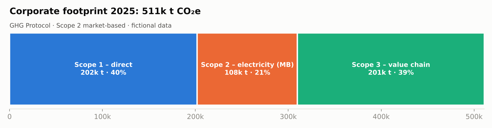

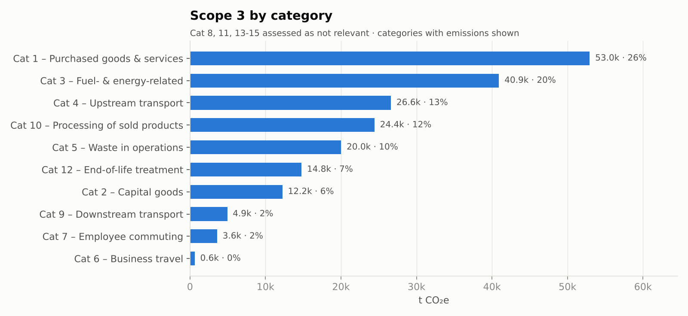

**Key insights**

- **The Scope 3 total is driven by a few categories.** Purchased goods (Cat 1), fuel upstream (Cat 3), transport (Cat 4) and processing of sold board (Cat 10) make up about 70 % of Scope 3.
- **Recovered paper is a low-carbon raw material.** Under the cut-off approach it carries only collection and sorting emissions (~0.015 kg CO₂e/kg). The mill's energy use is the hotspot, not the fibre.
- **Supplier data matters most where factors are high.** Starch, inks and chemicals are small by mass but dominate Cat 1 emissions.

---

## 4. Product carbon footprints (LCA)

| Product | Functional unit | PCF (cradle-to-gate, fossil) | Main hotspot |
|---|---|---:|---|
| Recycled cartonboard | 1 t | **717 kg CO₂e** | Natural gas for steam & drying (48 %) |
| Folding carton | 1 t | **1,057 kg CO₂e** | Board input incl. 12 % trim (77 %) |
| Gypsum board 12.5 mm | 1 m² | **2.26 kg CO₂e** | Board drying + calcination gas (60 %) |

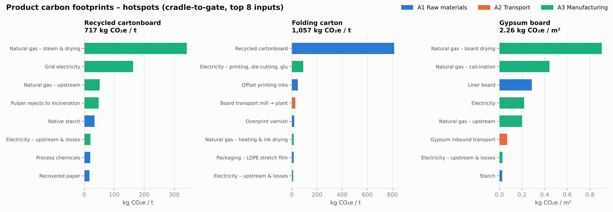

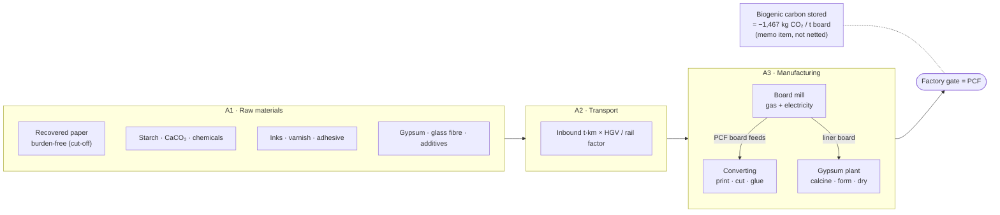

---

## 5. Supplier data & sustainable procurement

### Data validation logic (PACT Pathfinder)

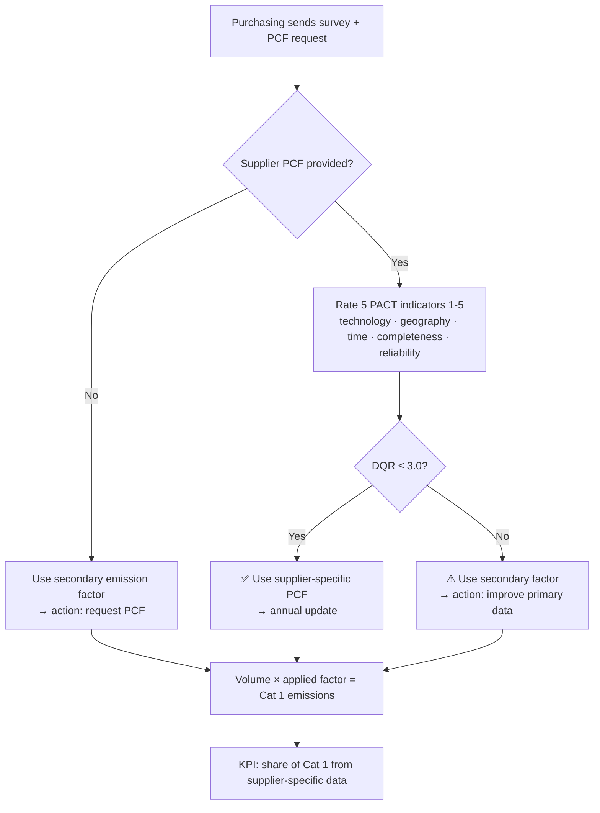

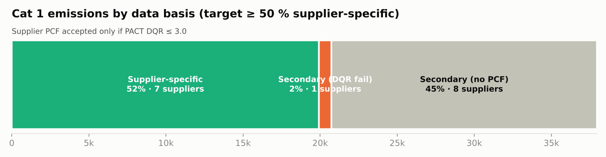

### ESG scorecard

Score = 30 % Environment + 20 % Labour & Human Rights + 15 % Ethics + 10 % Sustainable Procurement + 25 % Climate maturity. Climate maturity combines SBTi target, accepted PCF, ISO 14001 and ISO 50001.

| Rating | Score | Action |
|---|---|---|
| **A** – Strategic partner | ≥ 70 | Joint decarbonisation roadmap, PCF exchange |
| **B** – Develop | ≥ 55 | Request EcoVadis + SBTi commitment |
| **C** – Improvement plan | ≥ 40 | Corrective action plan within 6 months |
| **D** – Escalate | < 40 | Escalate to category management, audit |

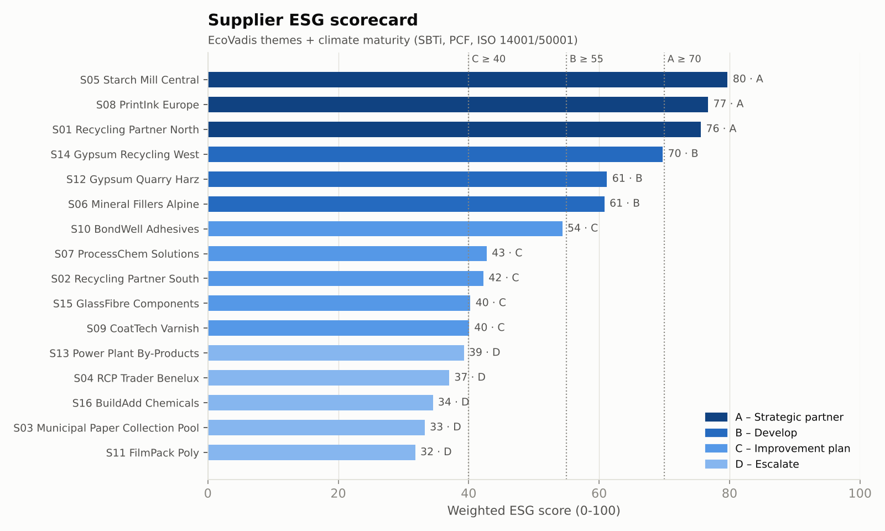

---

## 6. Decarbonisation levers

Ten levers identify **~142,000 t CO₂e/yr (≈ 28 %)** of reduction potential. The abatement cost is (capex ÷ lifetime + Δ opex) ÷ annual reduction.

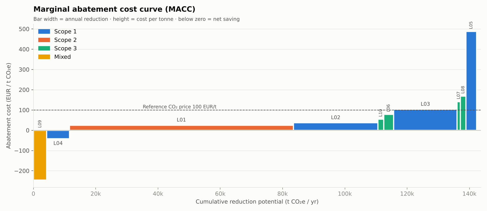

| ID | Lever | Scope | t CO₂e/yr | EUR/t |
|---|---|---|---:|---:|
| L09 | Board lightweighting in folding cartons (−5 % grammage) | Mixed | 4,276 | −246 |
| L04 | Heat recovery in gypsum board dryers | S1 | 7,272 | −41 |
| L01 | Additional renewable PPA (+50 % of electricity) | S2 | 71,933 | 25 |
| L02 | Heat pumps / MVR for board drying steam | S1 | 27,153 | 37 |
| L10 | Electric collection trucks at RCP suppliers | S3 | 1,845 | 54 |
| L06 | Low-carbon starch (supplier engagement) | S3 | 3,199 | 78 |
| L03 | Electrode boiler on renewable power | S1 | 20,365 | 103 |
| L07 | Low-carbon / bio-based inks | S3 | 1,063 | 141 |
| L08 | Modal shift of RCP inbound to rail | S3 | 1,779 | 169 |
| L05 | Biomethane for gypsum calcination | S1 | 3,386 | 487 |

---

## 7. How the model works

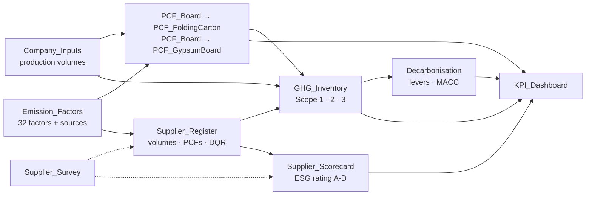

- **Every result is a formula** (711 formulas, zero errors). Change any blue input cell and the whole model updates.
- **Built-in checks.** Mass balances reconcile recovered paper and gypsum in the supplier register against what production needs (deviation ≤ 2 %).
- **Colour code.** Blue on yellow = input, black = formula, green = link to another sheet.

---

## 8. Repository structure & how to run

```
circular-carbon-toolkit/
├── model/LCA_CO2_Supplier_Toolkit.xlsx   # the Excel model (13 sheets)
├── docs/index.html                        # interactive dashboard (GitHub Pages)
├── docs/methodology.md                    # standards, boundaries, assumptions
├── assets/                                # diagrams, chart PNGs, screenshots
├── data/                                  # CSV/JSON exports of model results
├── src/
│   ├── build_workbook.py                  # generates the Excel model
│   ├── export_data.py                     # workbook → CSV/JSON
│   ├── make_charts.py                     # JSON → PNG charts
│   ├── dashboard_template.html            # dashboard source
│   └── build_dashboard.py                 # JSON → docs/index.html
└── requirements.txt
```

```bash
pip install -r requirements.txt
python src/build_workbook.py      # 1. build the Excel model
# 2. open the workbook in Excel and save it once (or run a LibreOffice recalc) so the formula values are calculated
python src/export_data.py         # 3. export results
python src/make_charts.py         # 4. README charts
python src/build_dashboard.py     # 5. dashboard
```

---

## 9. Methodology & limitations

See [`docs/methodology.md`](docs/methodology.md) for details. In short:

- **Standards:** ISO 14040/44, ISO 14067, GHG Protocol Corporate, Scope 2 & Scope 3 Standards, GHG Protocol Product Standard, PACT Pathfinder v3, CEPI Carbon Footprint Framework, EN 15804.
- **Boundary:** cradle-to-gate (A1-A3), GWP100 (IPCC AR6), fossil GHG only. Biogenic carbon is reported separately.
- **Recycling allocation:** cut-off (recycled-content) approach. Recovered paper and trim carry no burden from their first life.

> ⚠️ **Disclaimer:** the company, suppliers and all figures are **fictional**. Emission factors are rounded, indicative values typical of public sources (UBA, DESNZ, AIB, ecoinvent-type averages). They are not verified and must be replaced with licensed data before any real reporting (CSRD/ESRS E1, customer PCF requests, EcoVadis).

## License

MIT. See [LICENSE](LICENSE).
